<!-- _paginate: false -->
<!-- _footer: "" -->

DevOps Days Juiz de Fora 2026

<h1>Velero + RustFS: backup open source para clusters Kubernetes</h1>

<strong style="font-size: 1.2em; color: #F8FAFC;">Emerson Silva</strong>

Cloud Native &amp; Open Source Infrastructure

---
<!-- _paginate: false -->

# 🇧🇷 Emerson Silva

* Engenheiro DevOps na **4Linux**
* +9 anos em ambientes DevOps críticos
* Foco em **Kubernetes**, IaC e confiabilidade
* Palestrante, instrutor,escritor , ex-zagueiro 
* Community Lead de Kubernetes na DOUGBrazil
* Organizador do CNCF Campinas

  
  

    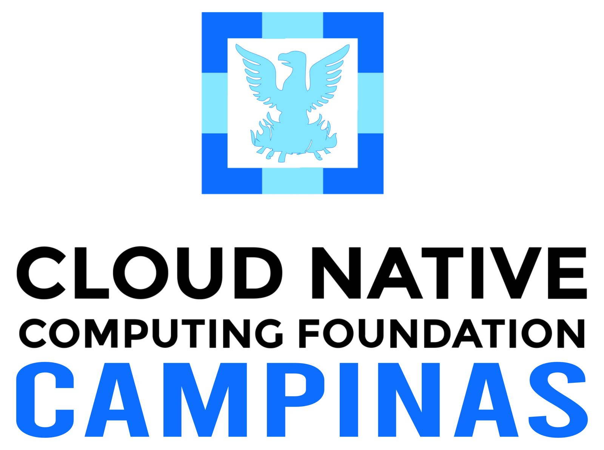
    
  

---
<!-- _paginate: false -->
<!-- _footer: "" -->

Fundada em 2001, a 4Linux participou das principais transformações da área de tecnologia. Começamos com Linux e software livre, navegamos por Cloud, DevOps e Containers — e hoje atuamos com agentes de IA, sempre com base em **inovação aberta**.

  
2001Linux & Software Livre

  
2008DevOps

  
2016Containers & Kubernetes

  
2019Machine Learning

  
2020Cloud

  
2024+IA com Open Source

---
<!-- _paginate: false -->

## O que veremos hoje

1. Kubernetes não é backup
2. RPO e RTO
3. Estratégias de DR
4. Velero e RustFS
5. Demo: backup e restore entre clusters

---

## Kubernetes não é backup

* Kubernetes resolve **disponibilidade**: réplicas, self-healing, rolling update
* Não resolve **recuperação**: o que é apagado some em todas as réplicas
* **Réplicas replicam o estado ruim**

---

## O que pode dar errado

* `kubectl delete namespace` no cluster errado
* GitOps que sincronizou uma remoção indesejada
* Corrupção do etcd ou perda do control plane
* Perda de zona ou região inteira
* Credencial comprometida usada para apagar recursos

---

## RPO e RTO

| | Pergunta | Exemplo |
|--|--|--|
| **RPO** | Quanto dado posso perder? | Backup a cada 6h: até 6h perdidas |
| **RTO** | Quanto tempo fora do ar? | Detectar, decidir, restaurar, validar |

> Esses dois números definem a frequência do backup e o quanto o restore precisa ser automatizado

---

## O que um backup precisa cobrir

* **Recursos da API**: Deployments, Services, ConfigMaps, Secrets, CRDs, RBAC
* **Dados de volumes**: bancos, uploads, filas
* Backup só de manifesto é **restauração parcial**

---

## Estratégias de DR

| Estratégia | Como funciona | Quando faz sentido |
|--|--|--|
| Backup e restore | Snapshots em storage externo, restore sob demanda | Maioria dos casos |
| Warm standby | Cluster secundário reduzido, dados replicados | RTO menor, com custo de manter dois ambientes |
| Active-active | Dois ambientes servindo tráfego | RTO e RPO próximos de zero, complexidade alta |

> Para a maioria dos times, backup e restore bem testado entrega mais valor

---

## O backup precisa sair do cluster que pode cair

* Se o backup mora no mesmo cluster, o desastre leva os dois
* Armazenamento externo, independente do cluster
* Object storage S3: barato, escalável, retenção longa
* O cluster de DR precisa **enxergar** o backup

---

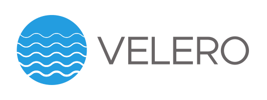

* Ferramenta open source, originalmente da VMware
* Roda como controlador dentro do cluster
* Lê os recursos da API, empacota e envia para o storage
* No restore, recria os recursos em outro cluster que enxergue o mesmo storage

---

## Componentes do Velero

* **Velero server**: executa backups, restores e schedules
* **node-agent**: move dados de volumes quando não há snapshot
* **BackupStorageLocation (BSL)**: onde os backups são gravados
* **Backup, Restore, Schedule**: recursos que representam cada operação

---

* Object storage **compatível com S3**
* Escrito em **Rust**
* Modo distribuído com **erasure coding**: tolera a perda de nós
* Console web e API S3 no mesmo serviço

---

## Como o Velero fala com o RustFS

* Plugin AWS (`velero-plugin-for-aws`), porque o RustFS é S3
* `s3Url` apontando para o endpoint do RustFS
* `s3ForcePathStyle=true`
* `region=minio`, já que o RustFS aceita qualquer valor
* BSL `from-prd` **somente leitura** no DR

---

## Arquitetura

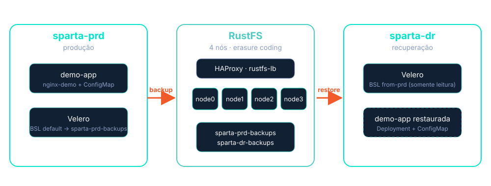

---

## Demo

Prints do lab, na ordem do fluxo: storage, instalação, backup e restore.

---

## RustFS com um bucket por cluster

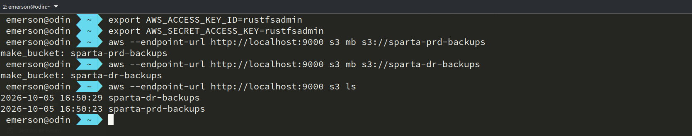

---

## Os dois clusters

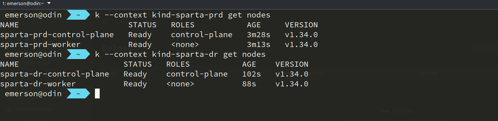

---

## Velero instalado em produção

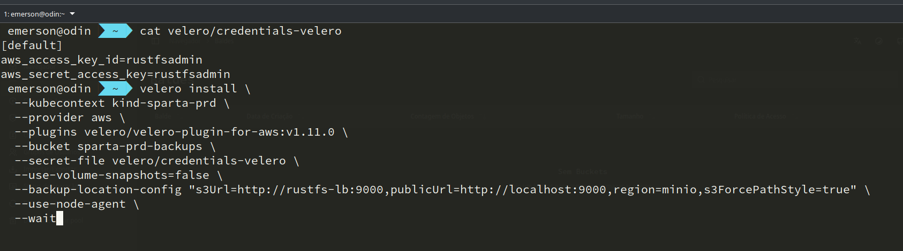

---

## BackupStorageLocation disponível

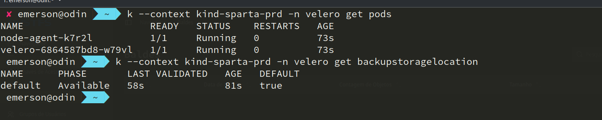

---

## BSL somente leitura no DR

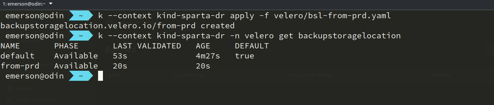

---

## Aplicação rodando em produção

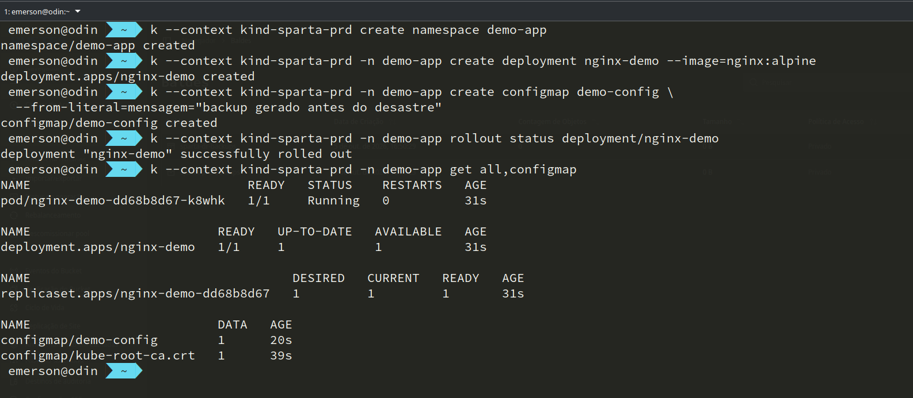

---

## Backup criado

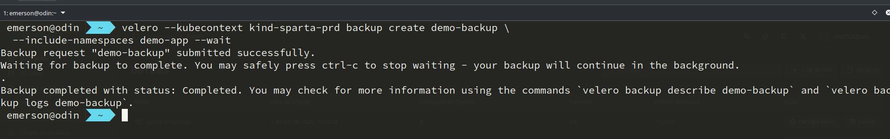

---

## Detalhes do backup

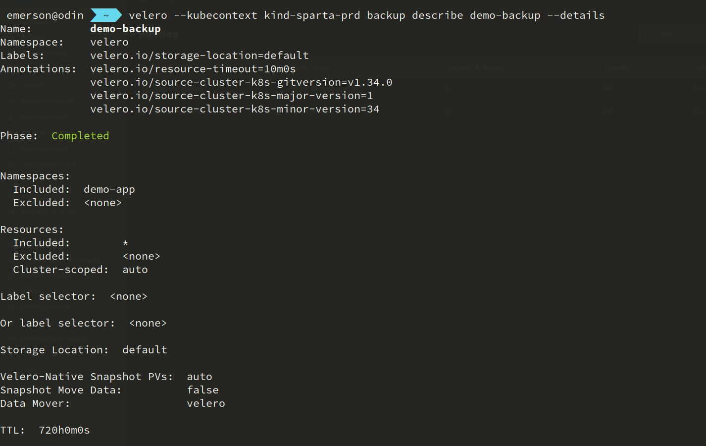

---

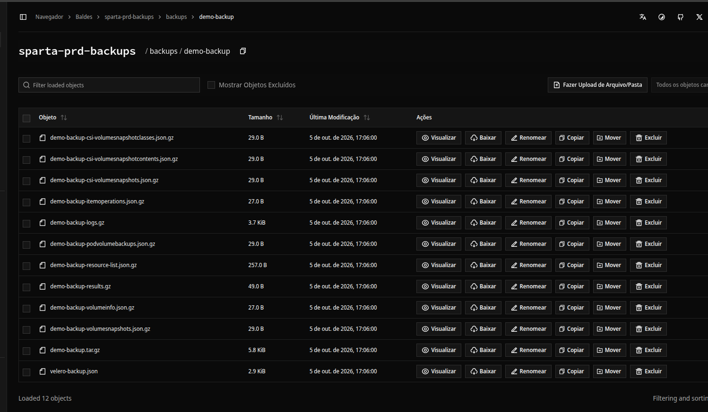

---

## Antes do restore: o DR não tem a aplicação

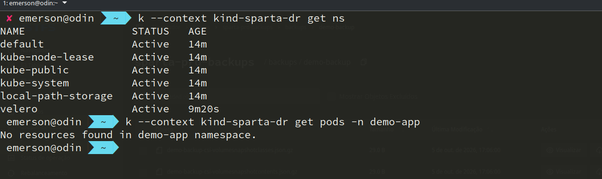

---

## Backup visível no DR e restore disparado

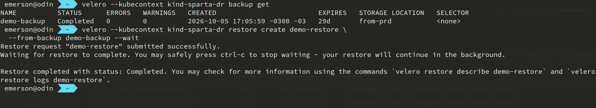

---

## Restore concluído

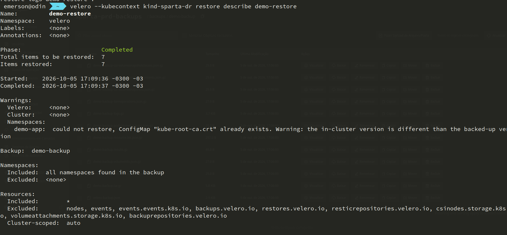

<!-- Warning esperado: o ConfigMap kube-root-ca.crt já existe no DR. Explicar que é esperado e não afeta o restore. -->

---

## Recursos recriados no DR

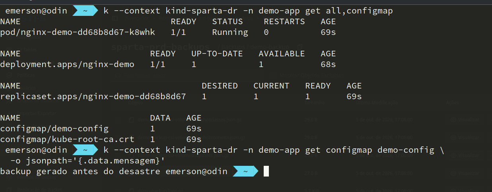

---

## Schedule diário

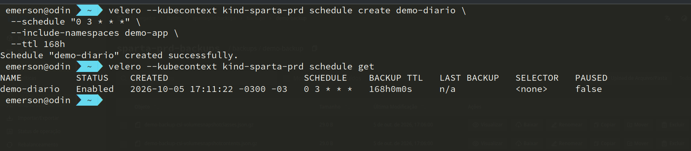

<!-- Extra: mostrar só se sobrar tempo. -->

---
<!-- _paginate: false -->

## Conclusão

* **Backup de Kubernetes é obrigatório**
* **Teste o restore antes do desastre**
* **Velero + RustFS: open source de ponta a ponta**

  
Backup que nunca foi restaurado <strong>não é backup</strong>

---
<!-- _paginate: false -->

## Curso gratuito

### DevOps, AIOps e SRE Fundamentals

Curso gratuito da 4Linux

Escaneie o QR code pra se inscrever

* 🎓 4linux.com.br/cursos

---
<!-- _paginate: false -->
<!-- _footer: "" -->

## Obrigado!

### Contato

* 💻 github.com/silvemerson/infra-velero-rustfs
* 📖 velero.io
* 📝 emerson-silva.blog.br
* 💬 @silvemerson

Vamos manter contato!

